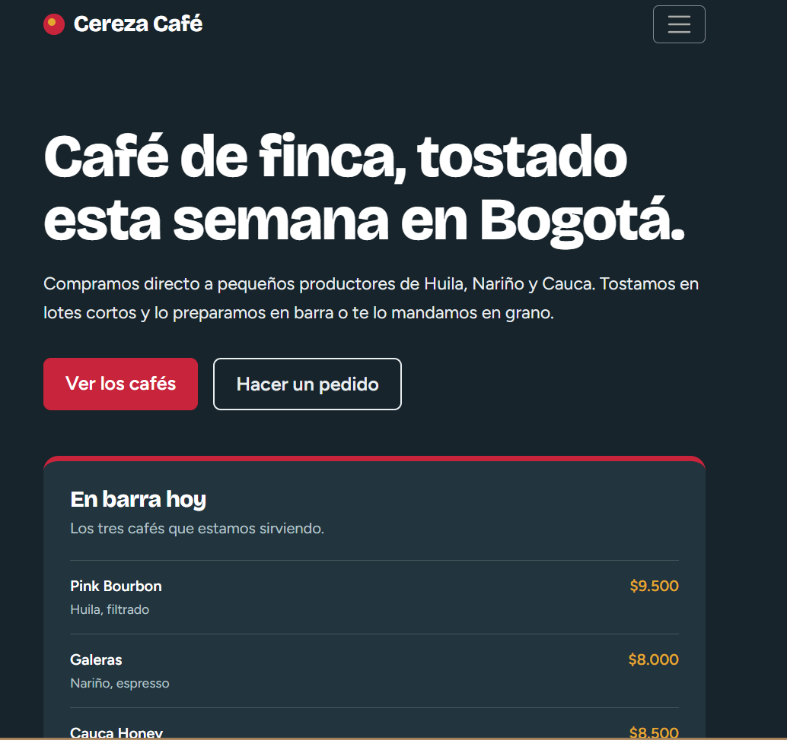
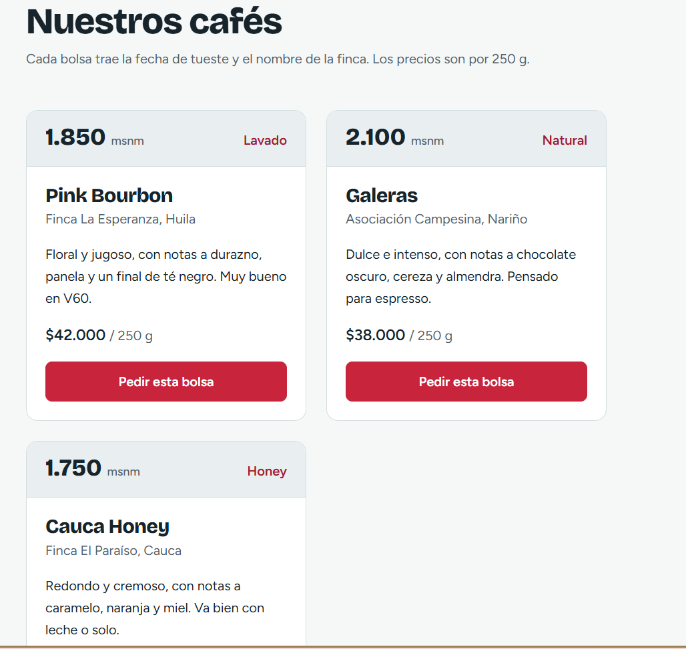
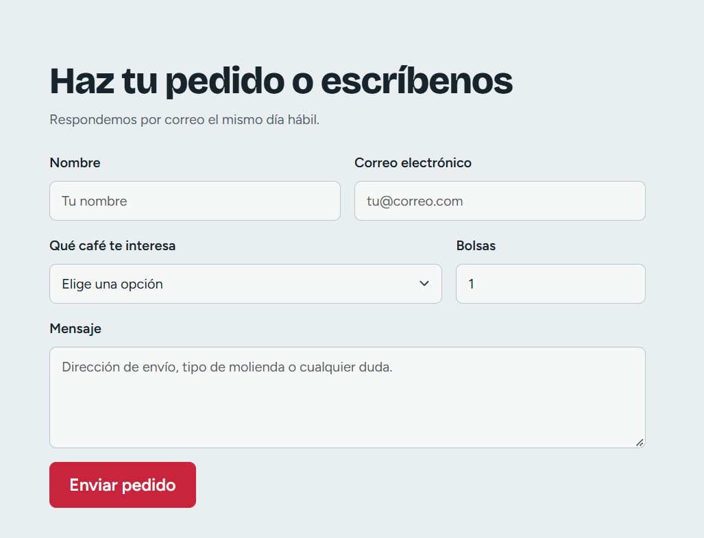
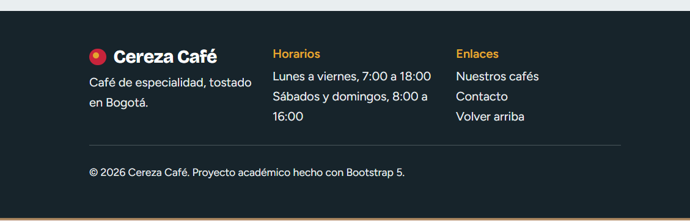
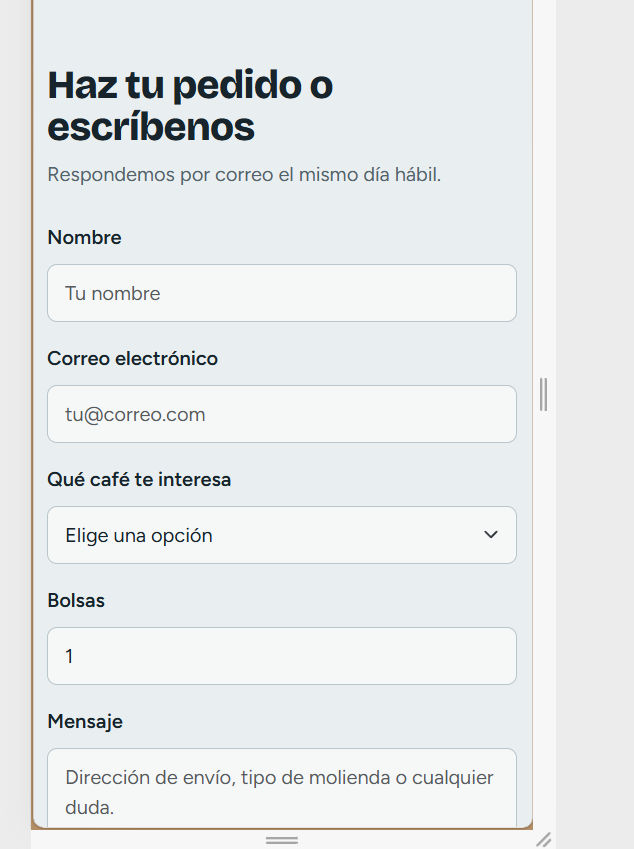
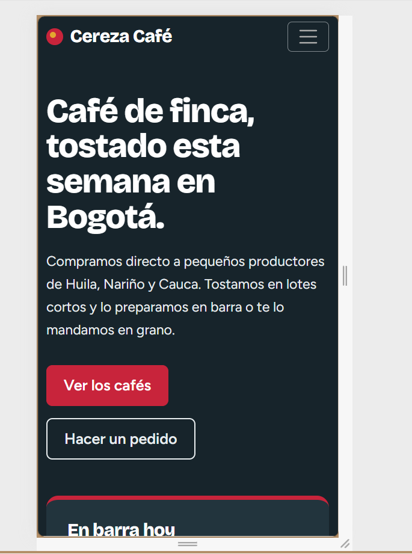
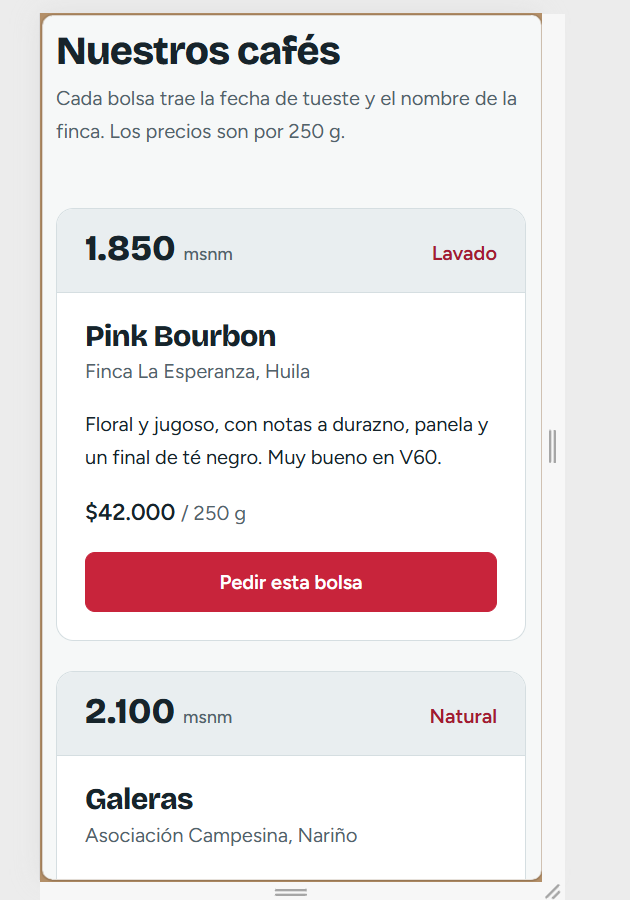

# Cereza Café: Taller "Rediseñando una Página Web"

Página de una tostadora de café de especialidad en Bogotá. Tiene los cinco bloques que pide el taller:

1. **Header:** logo y navegación principal (menú hamburguesa en celular).
2. **Hero:** título, subtítulo, botón principal y el panel "En barra hoy".
3. **Grid de cards:** 3 tarjetas de café (1 columna en móvil, 2 en tablet, 3 en escritorio).
4. **Formulario:** campos de contacto y pedido, con validación.
5. **Footer:** horarios, enlaces y créditos.

## Framework elegido: Opción B (Bootstrap 5)

Elegí Bootstrap porque resuelve rápido lo que más importa en este taller:

- El **sistema de grid** (`row` y `col-*`) hace que las cards y el hero se adapten a móvil, tablet y escritorio sin escribir media queries.
- La **navbar** trae el menú hamburguesa ya funcional.
- Los estilos de **validación de formularios** (`was-validated`, `invalid-feedback`) ahorran mucho CSS y JavaScript.

Sobre esa base agregué CSS propio (paleta, tipografía y tarjetas) para que la página no se vea como el Bootstrap por defecto.

## Identidad visual

- **Paleta:** azul petróleo oscuro (`#17242B`), niebla (`#E9EEF0`), rojo cereza (`#C8243B`) y ocre (`#E3A72F`). El rojo viene del fruto del café.
- **Tipografía:** Bricolage Grotesque para títulos y Figtree para el texto.

## Cómo ejecutarlo

Abre `index.html` en el navegador. Bootstrap y Google Fonts se cargan por CDN, así que necesitas conexión a internet.

## Capturas de pantalla

### Versión Desktop
La interfaz se adapta a pantallas de escritorio utilizando el sistema responsive de Bootstrap.

### Versión Mobile
La navegación, las tarjetas y el formulario se reorganizan para facilitar su uso desde dispositivos móviles.

